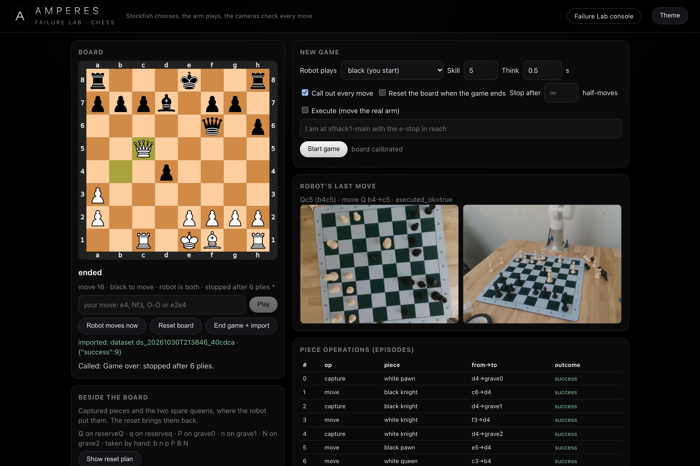
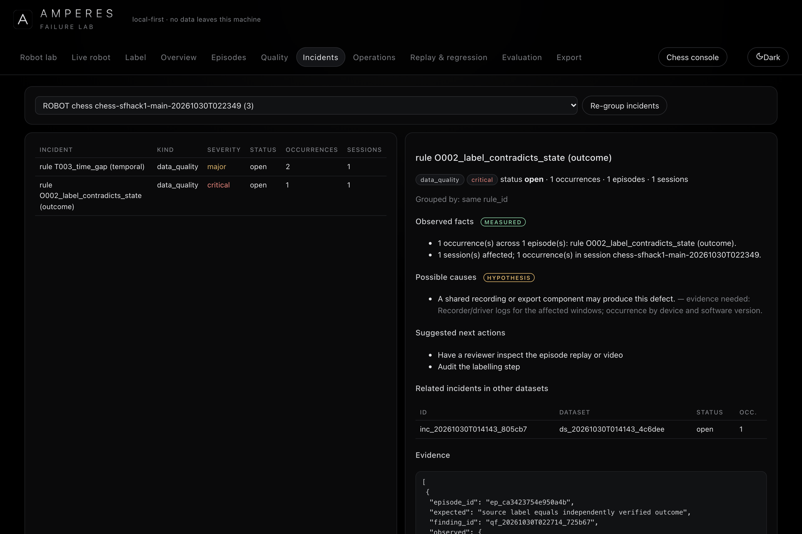
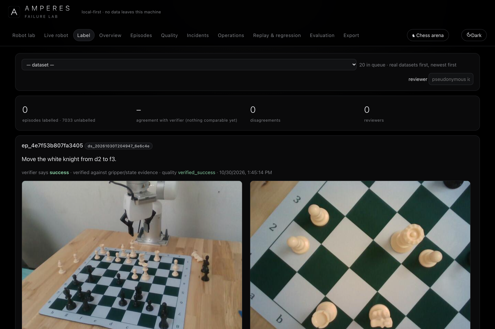
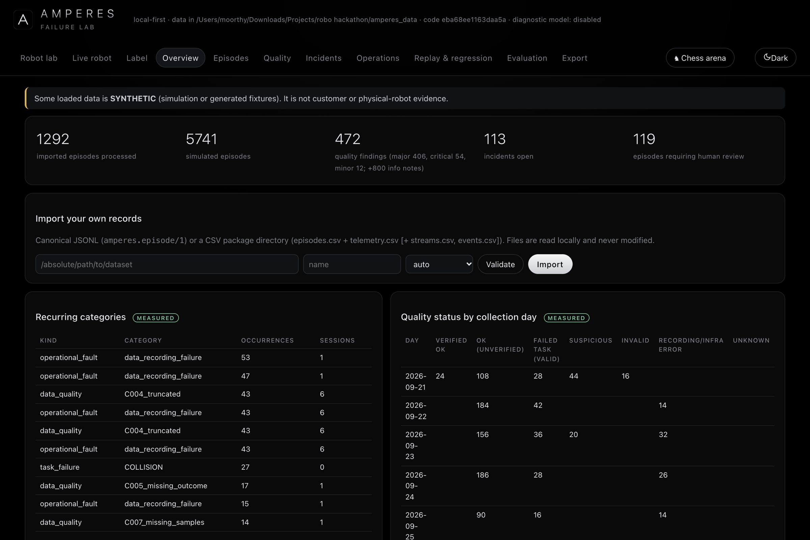
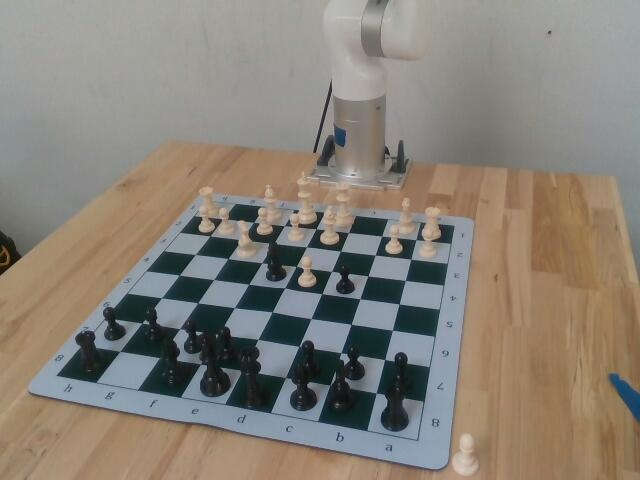
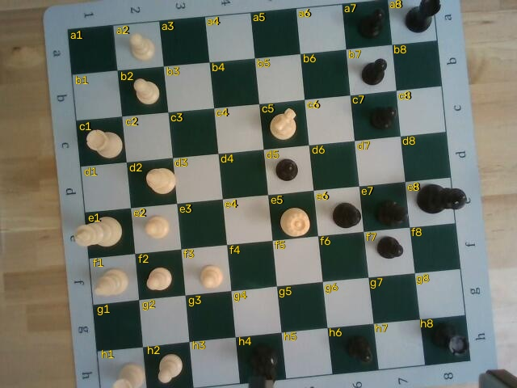
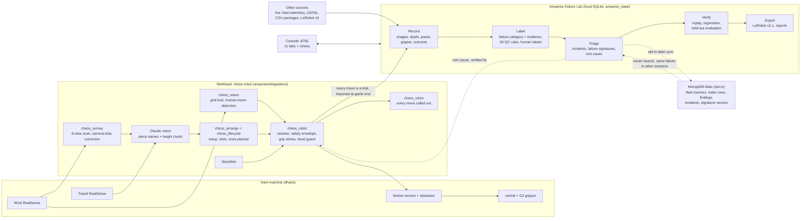

<p align="center"></p>

<h1 align="center">Amperes Failure Lab</h1>

<p align="center">
<b>Local-first failure analysis for robot manipulation: it records every attempt, labels each failure,<br>
traces it to a root cause, proves the fix on replay, and exports clean training data.</b>
</p>

<p align="center">
Live proof: a UFactory xArm6 that plays chess on a real board, where every move it makes is a trial the lab records and triages.
</p>

<p align="center">
<a href="https://vnmoorthy.github.io/amperes-haunted-chess/"><b>Landing page</b></a> ·
<a href="deck/Amperes_Failure_Lab.pdf"><b>Pitch deck</b></a> ·
<a href="docs/STORYBOARD.md"><b>3-minute storyboard</b></a> ·
<a href="docs/DEMO_DAY.md"><b>Demo runbook</b></a>
</p>

<p align="center">


</p>

Built over two days at the Viam × MongoDB robot hackathon in San Francisco: the Failure Lab and the first chess games
against a person on 29 Oct 2026, then the full chess robot (board setup, robot vs robot, move calls, board reset) on
30 Oct, on a real UFactory xArm6 (Viam machine `sfhack1`). Robot numbers below were measured on that arm unless marked
as simulated.

## Why

Robot manipulation fails in ways that are slow and expensive to diagnose. A missed grasp, a slip or a protective stop
leaves behind joint logs, camera frames and gripper readings spread across tools, none of them labelled, and someone has
to work out by hand whether the robot, the perception, the plan or the data pipeline was at fault. Teams that train on
these recordings pay twice: silently unusable episodes reach training, while failed-but-valid attempts, which are good
training data, get thrown away. And a fix is rarely checked against the cases that used to pass.

## What the lab does

**Record → label → triage → verify → export**, for every attempt, in one local console at `http://127.0.0.1:8765`.

| Step | What happens | Console tabs |
|---|---|---|
| **Record** | Each attempt becomes one episode in a canonical schema (`amperes.episode/1`): colour and depth images, commanded and reached poses, gripper readings, timing and outcome. Supervised robot runs, read-only live telemetry, recorded Viam sessions, JSONL, CSV packages and LeRobot v3 datasets all land in the same store. | Robot lab, Live robot |
| **Label** | Each failure gets a category and the evidence behind it: missed grasp (`GRASP_FAILURE`), slip (`SLIPPAGE`), collision stop (`SAFETY_STOP`), unsafe motion refused (`SAFETY_REFUSAL`), piece not moved (`PIECE_NOT_MOVED`), timeout, infrastructure error. 26 deterministic data-quality rules give every episode one status: usable, suspicious, invalid, or failed-but-valid. People can label outcomes too, and the label history is kept. | Label, Episodes, Quality |
| **Triage** | Recurring failures are grouped deterministically into incidents, each with an owner, a status history, measured facts and hypotheses kept apart. Every failed episode gets a deterministic failure signature, similar-failure search finds the same failure in other sessions, and every unusable episode is traced to exactly one cause. | Overview, Incidents, Operations |
| **Verify** | Reproduce a failure by replay, turn an incident into a regression case, and compare a fix on held-out conditions with confidence intervals, so a fix that breaks passing cases is caught before it ships. | Replay & regression, Evaluation |
| **Export** | LeRobot v2.1 datasets that load without Amperes code, incident and pilot reports in Markdown and JSON, experiment bundles. | Export, Incidents (LeRobot export runs from the command line) |

**Local-first.** The store is a SQLite database under `amperes_data/` and stays on the machine. Only two things send
data out, and only if you turn them on: MongoDB Atlas sync (`MONGODB_URI`), and board photos sent to Claude for piece
recognition (`ANTHROPIC_API_KEY`).

### Fleet memory on MongoDB Atlas (opt-in)

One robot's failures are more useful next to every other robot's. With `MONGODB_URI` in `.env`
(`scripts/set_mongodb_uri.py` writes it without showing the password), each station syncs a compact index of what it
recorded to one Atlas cluster, and Atlas Vector Search finds the same failure across sessions and stations:

```bash
.venv/bin/python -m amperes.cli atlas sync <dataset_id>          # index rows, findings, incidents, events, signatures
.venv/bin/python -m amperes.cli atlas similar <episode_id> -k 6  # Atlas Vector Search for the 6 closest failures
```

- **What is sent:** episode index rows, quality findings, incidents, events, and one failure-signature vector per
  episode. Raw streams are not sent. Re-running a sync updates the same records.
- **What a signature is:** a deterministic vector built from the recorded evidence (quality rules fired, quality status,
  event classes, failure category). There is no learned embedding, so a match means the recorded evidence is alike.
- **Result on this arm:** all 39 robot sessions are synced. A missed grasp from a chess game on 30 Oct
  (episode `ep_3a3941af689d14f7`) matched 6 missed grasps with identical recorded evidence in other sessions, one of
  them from the evening before.
- **In the console:** an episode's detail (Episodes tab) has *Find similar failures* (local) and, when `MONGODB_URI` is
  set, *…across all stations (Atlas Vector Search)*. A Live robot capture or a Robot lab run offers *Sync to MongoDB
  Atlas*; chess games are synced with the command above. `similar <episode_id>` runs the same search locally, without
  Atlas.

## The proof: a robot that plays chess

**Why chess.** It is a hard, honest test for a pick-and-place robot: 32 small pieces in six shapes, millimetre
placement, a person's hands right next to the arm, and every move can be checked: by the rules of chess and by the
wrist camera, while the tripod camera records it. If the lab can debug that, it can debug your pick-and-place cell.

**The robot.** Viam machine `sfhack1`: a UFactory xArm6 with a G2 gripper, an Intel RealSense on the wrist and a second
RealSense on a tripod, planned through Viam's motion service with modelled obstacles. Stockfish picks the moves. Claude
vision names the pieces, cross-checked against heights measured by the depth camera.

**What it does.**

- **Sets up the board by itself.** From a messy table of upright pieces it scans six close views, locates every piece in
  arm coordinates, names it, and puts every piece on its start square in an order the gripper can manage.
- **Plays a person.** The wrist camera sees your move (two frames must agree on one legal move; castling and captures
  included), or you type it. Stockfish answers and the arm plays the reply.
- **Plays both sides by itself.** Choose *Robot plays: both sides* and it plays a whole game robot against robot, with an
  optional half-move limit.
- **Calls out every move.** After each and every move, by either side, whether the arm made it, the camera saw it or
  someone typed it, the Mac says it in plain words, squares in capitals: "White knight to F3, check." The result is
  announced when the game ends.
- **Never records a move that did not happen.** A grip that closes on air is caught by the gripper's finger position and
  retried at once at small offsets. After every move the wrist camera checks the board; when the gripper and the camera
  both say a move did not happen, it is redone, not recorded. If they disagree, the move stands and the trial is flagged
  for review.
- **Stops for hands.** Before every descent the wrist depth camera looks under the gripper and holds the arm still if
  anything is there that is taller than a chess piece; after 20 s it stops the session.
- **Resets the board after the game.** It tracks where every piece is, puts captured pieces in slots beside the board,
  keeps the spare queens in reserve for promotion, and plans the reset to keep the gripper clear of neighbours (600 of
  600 simulated scrambles with zero contact; any tight step is flagged).

**One robot turn:** look from above → lock the printed grid → wait for a legal move that explains the change →
Stockfish → pick-and-place with immediate grip retries → the wrist camera checks the board → commit, call the move out,
log the trial.

Every trial carries its images, poses, gripper reading and outcome. Trials show on the chess console as they happen and
land in the Failure Lab when the game ends (*End game + import*), where the lab triages the chess robot exactly as it
would triage your cell.

**Rehearsal, 30 Oct, 2:33 PM.** Robot vs robot from a mid-game position, 6 half-moves. The wrist camera confirmed all 6
and each was called out loud ("Black knight takes D4.", "White knight takes D4.", "Black pawn takes D4.", "White queen
to B4.", "Black queen to F6.", …), then "Game over: stopped after 6 half-moves." 9 pick-and-places, 0 failures.

## Failures it caught on the real arm, and the fixes

Each row is a failure we hit on the real arm while building the chess robot (29–30 Oct), what the recorded data showed,
and the fix.

| Symptom | What the data showed | Fix | Result |
|---|---|---|---|
| The gripper grasped air beside pieces | The survey camera's piece positions were off by about 15 mm, measured on pieces the arm itself had placed | A fitted correction (shift, rotation, scale) applied to every survey position | 4.5 mm mean error; **14 of 14** pick-and-places in a row |
| Retried grips pressed pieces into the board, which can break them | A retry grips 8 mm lower down the piece, but the piece was still set down at the planned height | Place height follows the height the piece is actually held at; the last 60 mm above the board runs at 10 deg/s, transit at 75 deg/s | A retried piece is set down, not pushed into the board |
| Moves recorded that never happened | The gripper reported a grab while the wrist camera showed the piece still on its square (`PIECE_NOT_MOVED`) | The finger position flags an empty grip; the arm retries at once at small offsets (up to six tries); a move that the gripper and the camera both say did not happen is redone (up to three rounds); a disagreement is flagged for review | A move both signals say did not happen is never recorded |
| The arm stopped on collision overcurrent during long, fast swings | Collision stops (`SAFETY_STOP`) on long swings and big wrist turns | Wrist turns over 90 degrees are split into two half-turns; motion is routed through the motion service in shorter moves | The arm's collision detection stays at its configured sensitivity; the moves are shaped to stay under it |
| The board-reset planner looped, moving the same piece back and forth | Reset plans walked back into board states they had already visited | Loop guard: visited states are remembered and never revisited, follow-up moves are forced, and the number of operations is capped | Every reset plan ends |
| A move typed into the console was ignored while the camera was watching | The typed move reached the game, but the camera watch kept waiting | The watch ends as soon as a move is entered, and the robot's reply follows | Typed and camera-seen moves both work at any point |
| Pieces mislabelled: a rook read as a pawn, a bishop misread | From straight above, rooks and pawns look alike; the names and the measured heights disagreed | Claude vision plus a measured-height check and a confidence gate; operator corrections stay attached to the piece as it moves | A wrong name is caught, or corrected once and the correction follows the piece |

### In the lab so far

Counted from `amperes_data/amperes.db` at 2:39 PM on 30 Oct, over two days, since the first chess game on the evening
of 29 Oct:

| | |
|---|---|
| Chess trials recorded on the real arm | **193**, in 36 chess sessions |
| Succeeded | 142 |
| Failed, each labelled with its category | 38: 30 missed grasps (`GRASP_FAILURE`), 7 slips (`SLIPPAGE`), 1 piece not moved (`PIECE_NOT_MOVED`) |
| Invalid, kept out of training data | 13: 8 safety stops, 5 infrastructure errors |
| Flagged critical by quality rule O002 | 2 trials whose recorded outcome contradicted independent verification |

## Screenshots

<table>
<tr>
<td width="50%"><br><sub><b>Chess console.</b> The board as the robot tracks it, its last move with before-and-after camera views, the pieces beside the board, and the new-game options: white, black or both sides, call out every move.</sub></td>
<td width="50%"><br><sub><b>Incidents.</b> Recurring failures grouped by cause, each with measured facts, hypotheses kept separate, next actions and related incidents in other datasets. Here: a camera dropout during a chess session on the real arm.</sub></td>
</tr>
<tr>
<td width="50%"><br><sub><b>Label.</b> A real chess move queued for review, with the verifier's call and both camera views.</sub></td>
<td width="50%"><br><sub><b>Overview.</b> Episodes processed, quality findings, open incidents, recurring failure categories and quality status by collection day. Synthetic data is labelled as such.</sub></td>
</tr>
<tr>
<td width="50%"><br><sub><b>Tripod camera.</b> The xArm6 mid-game on the real board.</sub></td>
<td width="50%"><br><sub><b>Wrist camera.</b> Looking straight down with the printed grid locked and every square named.</sub></td>
</tr>
</table>

## Architecture



The Failure Lab is the product; the chess robot is one workload feeding it. Any other robot feeds it the same way:
supervised runs through `viam_control`, read-only telemetry through `viam_live`, or files through the importers.

## Run the demo

```bash
git clone https://github.com/vnmoorthy/amperes-haunted-chess && cd amperes-haunted-chess
python3.12 -m venv .venv && .venv/bin/pip install -r requirements.txt
cp .env.example .env    # VIAM_API_KEY, VIAM_API_KEY_ID, VIAM_MACHINE_ADDRESS, optional ANTHROPIC_API_KEY
.venv/bin/python -m amperes.cli serve --port 8765        # console: http://127.0.0.1:8765, game page: /chess
```

1. **Set up the board by itself** (about 20 s per piece moved, plus a scan each round):
   `.venv/bin/python -m amperes.integrations.chess_arrange --ack "<operator phrase>"`.
   With `--plan-only` it looks, recognises and plans, and moves only to the look pose.
2. **Play a person** (5 min): on `/chess` choose *Robot plays* white or black, tick *Execute (move the real arm)*, type the
   operator phrase, then *Start game*. Play your side by hand; the wrist camera sees each move (or type it) and the robot replies.
3. **Let it play both sides:** choose *Robot plays: both sides (robot vs robot)*, optionally with *Stop after N half-moves*
   and *Reset the board when the game ends*. Over HTTP it is `POST /api/chess/new` with
   `{"color": "both", "max_plies": 8, "auto_reset": true}`; the arm moves only when `"execute": true` and `"ack"` are set.
4. **Hear every move:** *Call out every move* is on by default. After each move, by either side, the Mac says it in plain
   words ("White knight to F3, check.") and announces the result at the end. `AMPERES_VOICE=0` turns it off;
   `AMPERES_VOICE_NAME` picks another macOS voice.
5. **Show the data** (1 min): *End game + import*, only when the phase reads *your move* or *game over* (pressed while
   the arm is moving, it stops the arm mid-move, like STOP). The game's trials then appear in the Failure Lab as
   episodes, with QC findings and incidents.
6. **Find the same failure elsewhere** (opt-in): `.venv/bin/python -m amperes.cli atlas similar <episode_id> -k 6`, or
   *…across all stations (Atlas Vector Search)* on an episode's detail. See *Fleet memory on MongoDB Atlas* above.

Offline, with no robot: `.venv/bin/python -m amperes.integrations.chess_sim --scrambles 50 --games 5`,
`.venv/bin/python -m pytest`, and the lab's technical demo on synthetic and simulated data in a scratch store:
`AMPERES_HOME=/tmp/amperes_ref scripts/reproduce_all.sh && AMPERES_HOME=/tmp/amperes_ref scripts/demo_walkthrough.sh`.
Plain `scripts/reproduce_all.sh` wipes `./amperes_data`, including recorded robot sessions: never run it on the demo
machine.

## Measured on the event arm

| | |
|---|---|
| Rehearsal, robot vs robot from a mid-game position (30 Oct, 2:33 PM, 6 half-moves) | 9 of 9 pick-and-places; all 6 moves confirmed by the wrist camera and called out loud |
| Pick-and-places in game 1 against a person (29 Oct, 16 half-moves) | 10 of 10 (camera confirmed 6 of the 8 robot moves; 2 unclear, none contradicted) |
| Chess trials in the lab since the first game (to 30 Oct, 2:39 PM) | 193: 142 succeeded, 38 failed, 13 invalid (*In the lab so far* above) |
| Pick-and-places in a row after the camera-bias fix (30 Oct) | 14 of 14 |
| Survey position error, after the fitted correction | 4.5 mm mean (was about 15 mm) |
| Board-calibration offset measured against the printed grid | about 3 mm (corrected) |
| Reset planner, simulated scrambles of all 34 pieces (32 plus two spare queens) | 600 of 600, zero gripper contact |
| Workspace scans, commanded poses | 186 poses, 0.34 mm max error |
| Tests (`.venv/bin/python -m pytest -q`) | 132 passing |

## Reuse it on your robot

The Failure Lab takes any robot's recordings. The chess robot's parts are modules you can lift into your own Viam project:

| Module | What it gives you | Needs |
|---|---|---|
| `amperes` (the lab) | Episode schema, quality rules, incidents, failure signatures and similar-failure search, replay and regression, LeRobot v3 import and v2.1 export, opt-in Atlas sync and vector search, for any robot's data | Python 3.11+ |
| `amperes/integrations/viam_control.py` | Supervised Viam motion: safety envelope, speed profile, half-turn wrist moves, empty-grip check, watchdog, STOP | a Viam arm and gripper |
| `amperes/integrations/chess_lifecycle.py` | Where every piece is (board and slots beside it), the piece operations for any move (captures, castling, en passant, promotion with a spare queen), game-end rules, and a reset planner that orders pick-and-places to keep the gripper clear of neighbours, flagging any tight step. Pure Python | python-chess; three taught points; your gripper's size |
| `amperes/integrations/chess_sim.py` | Offline proof: replays plans on a virtual board and counts gripper contacts | Stockfish for engine games |
| `amperes/integrations/chess_survey.py` | Multi-view scan → every object in arm coordinates, with a fitted camera correction | a wrist RGB-D camera |
| `amperes/integrations/chess_claude_vision.py` | Board reads and piece IDs from any camera image, with a confidence per square; checks a believed position for anomalies | `ANTHROPIC_API_KEY` |
| `amperes/integrations/chess_vision.py` | Board grid from a depth camera, occupancy and colour per square, the human's move from what changed | an RGB-D camera |
| `amperes/integrations/chess_robot.py` | The supervised session: Stockfish, pick-and-place through the Viam motion service, grip retries, camera verification, hand guard | a Viam arm, gripper and camera |
| `amperes/integrations/chess_arrange.py` | The look → recognise → plan → move loop that sets up a board from a messy table | the modules above |
| `amperes/integrations/chess_voice.py` | Every move said in plain words | macOS `say` |

```python
from amperes.integrations import chess_lifecycle as L
from amperes.integrations.chess_robot import BoardCal

cal = BoardCal.load()                       # a1, h1 and the captured-piece spot, taught once
layout = {"e4": "P", "e2": "p", "e1": "K"}  # what is where (from the game record or a recognised board)
plan = L.plan_reset(cal, layout)            # every operation clean, or flagged as tight
for op in plan.ops:
    print(op.symbol, op.src, "->", op.dst, op.note)
```

Viam components are chosen by name, so any Viam arm, gripper and camera work: set `AMPERES_ARM`, `AMPERES_GRIPPER`,
`AMPERES_MOTION` and `AMPERES_CAMERAS` (wrist camera first). Details and hardware lessons: [CHESS](docs/CHESS.md),
[ROBOT_LAB](docs/ROBOT_LAB.md).

## Safety

- **Dry run by default.** The arm moves only when *Execute* is on and the operator types the acknowledgement, with the e-stop in reach.
- **Hand guard.** Before every descent the wrist depth camera looks under the gripper; anything more than 110 mm above the
  board (taller than any piece) makes the arm hold still, and after 20 s the session stops. If the wrist camera returns
  no frame, the descent goes ahead and the arm's own collision stop is the backstop.
- **Safety envelope.** Every target is checked against a box around the board; no orientation change above 100 degrees in
  one move; fingertips never closer than 5 mm to the board during play; carried pieces clear the tallest piece by 25 mm.
- **Gentle near the pieces.** Transit at 75 deg/s, the last 60 mm above the board at 10 deg/s; pieces are set down at the
  height they are held, never pushed into the board.
- **Watchdog and STOP.** A separate telemetry connection stops the arm after 10 s without data during motion; STOP works
  mid-move.
- **Ending a game.** *End game + import* pressed while the arm is moving stops it mid-move, like STOP, and can leave a
  piece in the gripper. End a game only when the phase reads *your move* or *game over*.
- **Collision detection untouched.** The arm's own collision detection stays at its configured sensitivity; moves are
  shaped to stay under it.

## Honest limitations

- Setup expects upright pieces. A top-down parallel gripper cannot reliably stand a fallen piece back up (an experimental
  righting move is in `chess_righting.py`), so a person stands it up.
- From straight above, a rook and a pawn look alike. Piece identity needs the height check and, now and then, an operator
  correction, which then follows the piece.
- Speed is capped by the arm's own collision detection: faster long swings trip it, so transit stays at 75 deg/s. Board
  setup takes about 20 s per piece moved; a full 32-piece setup has not been timed.
- Arm errors are not cleared automatically: after a collision stop, someone checks the arm in the Viam app.
- The hand guard needs a wrist camera frame; without one, the arm's own collision stop is the only backstop.
- Move call-outs use macOS `say`, so they need a Mac.
- Venue Wi-Fi drops: the telemetry link re-dials and a camera watch retries up to five times; a lost command link stops
  the move, and the game can be continued from its position ([DEMO_DAY](docs/DEMO_DAY.md), Recovery).

---

# Failure Lab reference

## Install

Prerequisites: Python 3.11+ (tested 3.12.4), macOS or Linux, no GPU, about 300 MB disk for the full reference run.

```bash
python3 -m venv .venv
```

```bash
.venv/bin/pip install -r requirements.txt
```

## Reproduce everything (about 2.5 minutes on an Apple M3)

**The script wipes its store first.** Plain `scripts/reproduce_all.sh` deletes `./amperes_data`, including recorded
robot sessions, so on a machine with real data (and always on the demo machine) point it at a scratch store:

```bash
AMPERES_HOME=/tmp/amperes_ref scripts/reproduce_all.sh
```

It runs the tests, the simulator experiment, the detector evaluation, and a shadow-mode evaluation of the synthetic
operations package. Reports are written to `$AMPERES_HOME/artifacts/reports/`.

## Try it on your own records

```bash
.venv/bin/python -m amperes.cli validate /path/to/your/package
```

```bash
.venv/bin/python -m amperes.cli shadow /path/to/your/package --name "my sample"
```

```bash
.venv/bin/python -m amperes.cli serve
```

Then open http://127.0.0.1:8765 (light and dark themes; system default, toggle in the header). Report charts are written
in both themes (`<chart>.png` light, `<chart>_dark.png` dark). Supported formats and required fields are listed in
[docs/INTEGRATION_GUIDE.md](docs/INTEGRATION_GUIDE.md). A tiny worked example is in
[examples/sample_package](examples/sample_package).

A LeRobot v3 dataset goes through the same rules, and any stored dataset exports as a LeRobot v2.1 directory:

```bash
.venv/bin/python -m amperes.ingest.lerobot_v3 /path/to/lerobot_v3_dataset --name "my lerobot data"
```

```bash
.venv/bin/python -m amperes.export_lerobot /path/to/out_dir <dataset_id>
```

To delete an imported dataset and everything derived from it:

```bash
.venv/bin/python -m amperes.cli delete-dataset <dataset_id> --yes
```

## Record a live robot (read-only)

```bash
.venv/bin/python -m amperes.cli viam record --seconds 60
```

Or use the **Live robot** tab. This captures read-only telemetry (joints, end pose, motion flags, camera frame health and
machine status) from the Viam machine in `.env`, segments it into episodes and audits them. Only five read methods are
callable; anything else raises before reaching the SDK (`tests/test_viam_live.py`). Supervised motion is a separate,
explicit path (`robot …` and the chess robot) behind the safety gates above.

Measured on `sfhack1` on 29 Oct 2026:
- **Default SDK client:** 51 of 59 arm reads failed, and the camera looked dead.
- **The recorder's own reconnect handling:** 154 of 155 reads succeeded and 19 of 20 camera frames arrived.
- **Cause:** the SDK's 1 s health check was tearing down a slow cloud-relayed link (p95 read latency about 1 s). The robot was fine.

To share failures across stations, see [Fleet memory on MongoDB Atlas](#fleet-memory-on-mongodb-atlas-opt-in) above.

## Evidence for the lab beyond the robot

> **What the evidence is.** The robot numbers above were measured on `sfhack1`, except the reset-planner figure, which is
> simulated. Every other number comes from MuJoCo simulation or clearly labelled **synthetic** fixtures. Nothing has been tested on customer data. No customer, including
> OpenAI, has evaluated, endorsed or requested this product. Workflow time savings have **not** been measured.

The lab also ships a small MuJoCo pick-and-place simulator: a reproducible test bench for the reproduce → intervene →
verify loop. You don't need it to use ingestion, quality control or triage on your own logs. Reproduced by
`scripts/reproduce_all.sh`:

| Capability | Evidence |
|---|---|
| MuJoCo pick-and-place task + scripted baseline + ground-truth verifier | 5,657 simulated episodes in the reference run |
| Deterministic failure taxonomy (collision, slippage, grasp, reach, placement, timeout, invalid) | `amperes/sim/taxonomy.py`; `tests/test_sim.py::test_classification` |
| Exact failure reproduction (closed-loop rerun and open-loop action replay) | 40/40 exact in both modes |
| Intervention chosen on dev only, then evaluated on 1,000 held-out conditions | baseline 862/1000 → 949/1000; 87 fixed, 0 broken; Δ +8.7 pp, 95% CI [7.0, 10.5]; exact McNemar p ≈ 1.3e-26 |
| Ablation catches a trade-off | fixed-height alternative: 911/1000, but **broke 33** previously passing conditions |
| Control arm (unchanged config) | 0 differences, so the harness adds no spurious effects |
| Canonical episode schema + JSONL and CSV-package importers | malformed records are rejected with field-level errors; the source is never modified |
| 26 data-quality rules (21 per-episode + 5 dataset-level: completeness, temporal, signal, outcome, dataset) | synthetic corpus: all 15 detectable defect types caught 4/4; 40/40 clean episodes kept; 16/16 failed tasks kept as valid data |
| Incident grouping, status history, incident → regression case | `amperes/incidents.py`; tests |
| Usable-data yield with **loss attribution** (each unusable episode traced once to its linked event or finding) | synthetic package: 51 unusable = 43 linked to `CAM_FRAME_DROP` events on wc-B + 8 missing outcome labels |
| Throughput, availability, MTTA/MTTR, bottlenecks, cross-session correlation | synthetic 3-workcell package: all six planted patterns surfaced (P1's per-session check flagged 5 of the 6 affected sessions) |
| Human review, counterbalanced workflow-timing study, economic model | instruments built; **no human data collected** |

## Main commands

All run as `.venv/bin/python -m amperes.cli <command>`.

| Command | Purpose |
|---|---|
| `serve` | Local API + console (127.0.0.1 only unless `--allow-remote`) |
| `demo`, `report <experiment>` | Simulator steps 1–8: baseline, failures, reproduction, variations, intervention, held-out comparison, regression, export; regenerate a report |
| `validate` / `import` / `shadow` | Schema check only / import + QC + incidents / read-only end-to-end evaluation with a source-unchanged check |
| `datasets`, `delete-dataset <dataset> --yes`, `schema` | List datasets; delete one and everything derived from it; print the episode JSON schema |
| `qc <dataset>` | Re-run quality rules on a stored dataset (works on simulator runs too) |
| `incidents build\|list\|show\|status\|export\|to-regression` | Incident triage |
| `ops metrics\|bottlenecks\|correlate <dataset…>` | Yield, throughput, reliability, associations |
| `review add\|report`, `study plan\|start\|finish\|report` | Human review; existing-vs-assisted timing study |
| `eval-detectors`, `fixtures defects\|ops --out <dir>` | Precision/recall on the labelled synthetic defect corpus; generate synthetic fixtures |
| `pilot-report <dataset…>` | Pilot readiness report (JSON + Markdown) |
| `reproduce <episode>`, `regress <suite>` | Replay one episode; rerun a regression suite against a policy config |
| `similar <episode>`, `atlas ping\|sync\|similar` | Similar-failure search, locally or through MongoDB Atlas (opt-in) |
| `viam record` | Read-only live telemetry capture, segmented and audited |
| `robot teach\|waypoints\|run\|scan\|chess` | Supervised arm work: teach spots, pick-and-place trials and A/B runs, workspace scans, chess calibration and play (`robot chess play --color white\|black`). Dry run unless `--execute` and `--ack` |

## Repository map

```
amperes/schema.py           canonical episode contract (amperes.episode/1)
amperes/ingest/             adapter interface, JSONL, CSV-package and LeRobot v3 importers, import pipeline
amperes/quality.py          data-quality rule engine and episode status
amperes/labels.py           human outcome labels and episode camera snapshots
amperes/incidents.py        deterministic grouping, status workflow, regression links
amperes/signatures.py       deterministic failure signatures + similar-episode search
amperes/ops.py              operational events, yield/throughput/reliability, bottlenecks, correlation
amperes/regression.py       regression suites
amperes/export_lerobot.py   LeRobot v2.1 export
amperes/review.py           human review + counterbalanced workflow study
amperes/economics.py        assumption-driven value model (refuses to compute without inputs)
amperes/pilot_report.py     pilot readiness report
amperes/sim/                MuJoCo env, baseline policy, verifier, taxonomy, variations, reproduction, interventions
amperes/integrations/       Viam: read-only live recorder, supervised control and tasks; chess robot modules
                            (chess_*.py); opt-in MongoDB Atlas sync + vector search
amperes/api.py, robot_api.py  local FastAPI service (robot_api: scans and the chess game)
amperes/ui/                 console (index.html) and chess game page (chess.html)
scripts/                    reproduce_all.sh, demo_walkthrough.sh, Atlas helpers
tests/                      132 tests
docs/                       robot lab, chess, protocol, architecture, limitations, security, integration, pilot and research documents
```

## Documentation

- Robot and demo: [ROBOT_LAB](docs/ROBOT_LAB.md), [CHESS](docs/CHESS.md), [DEMO_DAY](docs/DEMO_DAY.md),
  [DATASET_CARD](docs/DATASET_CARD.md)
- Technical: [ARCHITECTURE](docs/ARCHITECTURE.md), [EXPERIMENT_PROTOCOL](docs/EXPERIMENT_PROTOCOL.md),
  [LIMITATIONS](docs/LIMITATIONS.md), [DATA_SECURITY](docs/DATA_SECURITY.md), [INTEGRATION_GUIDE](docs/INTEGRATION_GUIDE.md),
  [IMPLEMENTATION_PLAN](docs/IMPLEMENTATION_PLAN.md), [TECHNICAL_DEMO_SCRIPT](docs/TECHNICAL_DEMO_SCRIPT.md)
- Phase reports: [PHASE2_GAP_AUDIT](docs/PHASE2_GAP_AUDIT.md), [PHASE2_FINAL_REPORT](docs/PHASE2_FINAL_REPORT.md),
  [PHASE3_PRODUCT_DECISION](docs/PHASE3_PRODUCT_DECISION.md), [PHASE3_FINAL_REPORT](docs/PHASE3_FINAL_REPORT.md)
- Hackathon: [STORYBOARD](docs/STORYBOARD.md); day-1 pitch, superseded (29 Oct, read-only audit):
  [HACKATHON_PITCH](docs/HACKATHON_PITCH.md), [OPENAI_PILOT_BRIEF](docs/OPENAI_PILOT_BRIEF.md)
- Commercial and discovery: [COMPETITIVE_GAP](docs/COMPETITIVE_GAP.md), [OPENAI_RELEVANCE](docs/OPENAI_RELEVANCE.md),
  [research/OPENAI_PUBLIC_SIGNALS](docs/research/OPENAI_PUBLIC_SIGNALS.md), [PHASE3_PILOT_OFFER](docs/PHASE3_PILOT_OFFER.md),
  [PILOT_PLAYBOOK](docs/PILOT_PLAYBOOK.md), [PILOT_PROPOSAL](docs/PILOT_PROPOSAL.md),
  [PILOT_ACCEPTANCE_CRITERIA](docs/PILOT_ACCEPTANCE_CRITERIA.md), [ECONOMIC_VALUE_MODEL](docs/ECONOMIC_VALUE_MODEL.md),
  [PHASE3_DIFFERENTIATION_TEST](docs/PHASE3_DIFFERENTIATION_TEST.md), [CUSTOMER_DISCOVERY](docs/CUSTOMER_DISCOVERY.md),
  [PHASE3_CUSTOMER_DISCOVERY](docs/PHASE3_CUSTOMER_DISCOVERY.md)

## Known limitations of the lab (short form; full list in [LIMITATIONS](docs/LIMITATIONS.md))

- The simulator is a Cartesian gantry with a parallel gripper, not an articulated arm. Simulator gains say nothing about real robots.
- Detector scores come from a synthetic corpus written by the same author as the rules, so they are a sanity check, not an accuracy claim.
- Importers cover canonical JSONL, the CSV package, LeRobot v3 and recorded Viam sessions. There are no MCAP/rosbag2 or robomimic HDF5 importers yet.
- Live outcomes from the read-only recorder are `unknown`, because monitoring alone cannot see task success; supervised runs verify outcomes from the gripper and the cameras.
