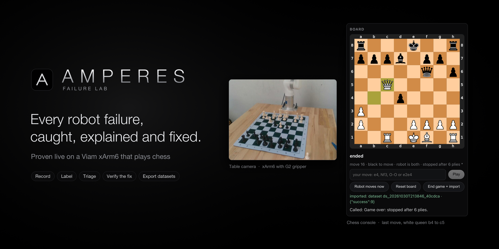
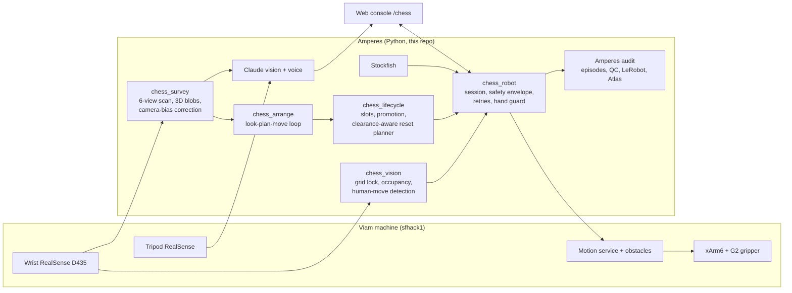

<p align="center"></p>

<h1 align="center">Amperes · Haunted Chess 🎃</h1>

<p align="center">
<b>A robot arm that sees your move, answers with Stockfish, taunts you in a spooky voice,<br>sets the board up by itself, and turns every move into audited robot-learning data.</b>
</p>

<p align="center">


</p>

📽️ **Pitch deck:** [deck/Amperes_Haunted_Chess.pptx](deck/Amperes_Haunted_Chess.pptx) ([PDF](deck/Amperes_Haunted_Chess.pdf)) · **3-minute storyboard:** [docs/STORYBOARD.md](docs/STORYBOARD.md)

Built in 48 hours at the Oct 2026 SF robotics hackathon on a real UFactory xArm6 with a gripper, a wrist RealSense
D435 and a second RealSense on a tripod. Everything below ran on that arm.

## What it does

| | |
|---|---|
| ♟️ **Plays you** | Stockfish picks the move; the arm picks the piece up and puts it down, fast through the air, slow and gentle in the last 6 cm. |
| 👁️ **Sees your move** | The wrist depth camera locks onto the printed grid and finds the legal move that explains what changed. No typing. Castling and captures included. |
| ✅ **Checks itself** | A grip that closes on nothing is retried at once. A move the camera does not confirm is retried, never recorded as played. |
| 🧩 **Sets up the board** | Six close views over the board and 10 cm around it; every piece located in arm coordinates, named by Claude, cross-checked by its height; a planner puts all 32 pieces home in an order the gripper can manage. |
| 🎙️ **Haunts you** | Claude writes a one-line taunt for each move; the Mac speaks it in a creaky voice. Checkmate is sung. |
| ✋ **Respects hands** | Before every descent the camera checks under the gripper; anything taller than a chess piece makes it hold still. |
| 📊 **Audits its data** | Every pick-and-place is an episode with a status and evidence, exportable to LeRobot and synced to MongoDB Atlas. |

## Architecture



**One robot turn:** look from above → lock the printed grid → wait for a legal move that explains the change (two
frames agree) → Stockfish (top-5, the hand prefers clean moves) → pick-and-place with immediate grip retries →
camera confirms the move → commit, speak, record the episode.

## Run the demo (10 minutes)

```bash
git clone https://github.com/vnmoorthy/amperes-haunted-chess && cd amperes-haunted-chess
python3.12 -m venv .venv && .venv/bin/pip install -r requirements.txt
cp .env.example .env    # VIAM_API_KEY, VIAM_API_KEY_ID, VIAM_MACHINE_ADDRESS, optional ANTHROPIC_API_KEY
.venv/bin/python -m amperes.cli serve --port 8765        # open http://127.0.0.1:8765/chess
```

1. **Set up the board by itself** (2–4 min): `python -m amperes.integrations.chess_arrange --ack "<operator phrase>"`
2. **Play** (5 min): on `/chess` pick *Robot plays white*, tick *Execute* and *Spooky voice*, type the operator
   phrase, *Start game*. Play Black by hand; the robot sees each move and replies.
3. **Show the data** (1 min): *End game + import* → the moves appear as episodes in the console, with QC findings.

Offline, with no robot: `python -m amperes.integrations.chess_sim --scrambles 50 --games 5` and `pytest`.

## Measured on the event arm

| | |
|---|---|
| Robot moves confirmed by the camera, game 1 (29 Oct) | 10 of 10 |
| Pick-and-places in a row after the camera-bias fix (30 Oct) | 14 of 14 |
| Survey position error, after the fitted correction | 4.5 mm mean (was ~15 mm) |
| Board-calibration offset measured against the printed grid | ~3 mm (corrected) |
| Reset planner, simulated scrambles of all 34 pieces | 600 of 600, zero gripper contact |
| Workspace scans, commanded poses | 186 poses, 0.34 mm max error |
| Tests | 130 passing |

## Reuse it on your robot

| Module | Gives you |
|---|---|
| `chess_lifecycle` | Physical layout, piece ops for any move (captures, castling, en passant, promotion with a spare queen), game end, clearance-aware reset planner. Pure Python. |
| `chess_survey` | Multi-view scan → every object in arm coordinates, with a fitted camera correction. |
| `chess_vision` | Board grid from a depth camera; human-move detection. |
| `chess_claude_vision` | Board reads and piece IDs from any image, with confidences. |
| `chess_robot` | Supervised Viam session: envelope, speed profile, retries, hand guard, camera verification. |
| `amperes` (rest) | Episode QC, incidents, LeRobot import/export, Atlas sync for any robot's data. |

Resource names come from `AMPERES_ARM`, `AMPERES_GRIPPER`, `AMPERES_MOTION`, `AMPERES_CAMERAS`.

## Safety

Dry run unless *Execute* is on and the operator types the acknowledgement · every target checked against a box around
the board · slow and gentle within 6 cm of the board, pieces released 3 mm above it · telemetry watchdog stops the
arm when data stops · STOP works mid-move · the arm's own collision detection stays at its configured sensitivity ·
hand guard before every descent.

## Honest limitations

It cannot stand up a fallen piece (a top-down parallel gripper can't). Telling a rook from a pawn from straight above
is hard; the robot remembers what it placed and a person can correct a label in one line. Venue Wi-Fi drops; the
robot reconnects and resumes.

---

# Amperes Failure Lab

A local-first tool for robotics data-acquisition and evaluation teams. It answers four questions about recorded
robot episodes:

1. Which episodes are **usable, suspicious, invalid, or failed-but-valid**, and what is the evidence?
2. Which failures **recur** across sessions, workcells and configurations?
3. Which failures can be **reproduced**, and which should become **regression tests**?
4. Did a proposed change **actually help**, measured on held-out conditions with uncertainty?

It also ships a small MuJoCo pick-and-place simulator. The simulator is a reproducible test bench for the
reproduce → intervene → verify loop. You don't need it to use ingestion, quality control or triage on your own logs.

> **What the evidence is.** Every number in this repository comes from either MuJoCo simulation or clearly labelled
> **synthetic** fixtures. Nothing has been tested on customer data or physical-robot logs yet. No customer, including
> OpenAI, has evaluated, endorsed or requested this product. Workflow time savings have **not** been measured.

## Chess robot toolkit (hackathon build, reusable on any Viam arm)

A Viam arm that plays chess against you, watches your moves, recognises pieces, tidies the board up after the game and
records every move as audited training data. Each part is a module you can lift into your own robot project:

| Module | What it gives you | Needs |
|---|---|---|
| `amperes/integrations/chess_lifecycle.py` | Where every piece is (board and spots beside it), the piece operations for any move (captures, castling, en passant, promotion with a spare queen), game-end rules, and a reset planner that orders pick-and-places so the gripper never touches a neighbour | python-chess; three taught points; your gripper's size |
| `amperes/integrations/chess_sim.py` | Offline proof: replays plans on a virtual board and counts gripper contacts | Stockfish for engine games |
| `amperes/integrations/chess_claude_vision.py` | Board reads and piece IDs from any camera image, with a confidence per square; checks a believed position for anomalies | `ANTHROPIC_API_KEY` |
| `amperes/integrations/chess_vision.py` | Board grid from a depth camera, occupancy and colour per square, the human's move from what changed | an RGB-D camera |
| `amperes/integrations/chess_robot.py` | The supervised session: Stockfish, pick-and-place through the Viam motion service, camera verification, safety envelope | a Viam arm, gripper and camera |
| `amperes/integrations/chess_voice.py` | Spoken move commentary (Claude-written lines, canned when offline) | macOS `say` |

```python
from amperes.integrations import chess_lifecycle as L
from amperes.integrations.chess_robot import BoardCal

cal = BoardCal.load()                       # a1, h1 and a graveyard spot taught once
layout = {"e4": "P", "e2": "p", "e1": "K"}  # what is where (from the game record or a recognised board)
plan = L.plan_reset(cal, layout)            # every operation clean, or flagged as tight
for op in plan.ops:
    print(op.symbol, op.src, "->", op.dst, op.note)
```

Another machine's resource names go in the environment: `AMPERES_ARM`, `AMPERES_GRIPPER`, `AMPERES_MOTION`,
`AMPERES_CAMERAS` (wrist camera first). The console's chess page is at `/chess`. `python -m amperes.integrations.chess_sim`
proves a planner change offline. Safety is the same everywhere: dry run unless Execute is on and the operator types the
acknowledgement, every target checked against a box around the board, slow within 12 cm of it, 5 mm steps near pieces,
and a telemetry watchdog. Details and measured results: [CHESS](docs/CHESS.md), [DEMO_DAY](docs/DEMO_DAY.md).

## Live on a real robot (Viam, read-only)

```bash
.venv/bin/python -m amperes.cli viam record --seconds 60
```

Or use the **Live robot** tab in the UI. This captures read-only telemetry (joints, end pose, motion flags, camera frame
health and machine status) from the Viam machine in `.env`, segments it into episodes and audits them. Only five read
methods are callable; anything else raises before reaching the SDK (`tests/test_viam_live.py`).

Measured on the hackathon arm `sfhack1` on 2026-10-29:
- **Default SDK client:** 51 of 59 arm reads failed, and the camera looked dead.
- **The recorder's own reconnect handling:** 154 of 155 reads succeeded and 19 of 20 camera frames arrived.
- **Cause:** the SDK's 1 s health check was tearing down a slow cloud-relayed link (p95 read latency about 1 s). The robot was fine.
- **Arm model:** not visible to the machine API key; the event page says the provided arms are UFactory xArm or UR.

**MongoDB Atlas (opt-in):** `atlas sync <dataset>` upserts episode status, findings, incidents, events and deterministic
failure signatures; `atlas similar <episode>` runs Atlas Vector Search across every synced station. It needs
`MONGODB_URI` in `.env`. `similar <episode>` gives the same search locally, without Atlas.

## What works (verified 2026-10-29 by `scripts/reproduce_all.sh` and 50 passing tests)

| Capability | Evidence |
|---|---|
| MuJoCo pick-and-place task + scripted baseline + ground-truth verifier | 5,657 simulated episodes in the reference run |
| Deterministic failure taxonomy (collision, slippage, grasp, reach, placement, timeout, invalid) | `amperes/sim/taxonomy.py`; `tests/test_sim.py::test_classification` |
| Exact failure reproduction (closed-loop rerun and open-loop action replay) | 40/40 exact in both modes |
| Intervention chosen on dev only, then evaluated on 1,000 held-out conditions | baseline 862/1000 → 949/1000; 87 fixed, 0 broken; Δ +8.7 pp, 95% CI [7.0, 10.5]; exact McNemar p ≈ 1.3e-26 |
| Ablation catches a trade-off | fixed-height alternative: 911/1000, but **broke 33** previously passing conditions |
| Control arm (unchanged config) | 0 differences, so the harness adds no spurious effects |
| Canonical episode schema + JSONL and CSV-package importers | malformed records are rejected with field-level errors; the source is never modified |
| 26 data-quality rules (21 per-episode + 5 dataset-level: completeness, temporal, signal, outcome, dataset) | synthetic corpus: all 15 detectable defect types caught 4/4; 40/40 clean episodes kept; 16/16 failed tasks kept as valid data |
| Incident grouping, status history, incident → regression case | `amperes/incidents.py`; tests |
| Usable-data yield with **loss attribution** (each unusable episode traced once to its linked event or finding) | synthetic package: 51 unusable = 43 linked to `CAM_FRAME_DROP` events on wc-B + 8 missing outcome labels |
| Throughput, availability, MTTA/MTTR, bottlenecks, cross-session correlation | synthetic 3-workcell package: all six planted patterns surfaced (P1's per-session check flagged 5 of the 6 affected sessions) |
| Human review, counterbalanced workflow-timing study, economic model | instruments built; **no human data collected** |
| Local API + single-page UI | `python -m amperes.cli serve` |

## Install

Prerequisites: Python 3.11+ (tested 3.12.4), macOS or Linux, no GPU, about 300 MB disk for the full reference run.

```bash
python3 -m venv .venv
```

```bash
.venv/bin/pip install -r requirements.txt
```

## Reproduce everything (about 2.5 minutes on an Apple M3)

```bash
scripts/reproduce_all.sh
```

The script wipes `./amperes_data`. It then runs the tests, the simulator experiment, the detector evaluation, and a
shadow-mode evaluation of the synthetic operations package. Reports are written to `amperes_data/artifacts/reports/`.

## Try it on your own records

```bash
.venv/bin/python -m amperes.cli validate /path/to/your/package
```

```bash
.venv/bin/python -m amperes.cli shadow /path/to/your/package --name "my sample"
```

```bash
.venv/bin/python -m amperes.cli serve
```

Then open http://127.0.0.1:8765. The UI follows the amperesai.com brand in light and dark themes (system default, toggle in the header). Report charts are written in both themes (`<chart>.png` light, `<chart>_dark.png` dark). Supported formats and required fields are listed in
[docs/INTEGRATION_GUIDE.md](docs/INTEGRATION_GUIDE.md). A tiny worked example is in
[examples/sample_package](examples/sample_package). To delete an imported dataset and everything derived from it:

```bash
.venv/bin/python -m amperes.cli delete-dataset <dataset_id> --yes
```

## Main commands

| Command | Purpose |
|---|---|
| `demo` | Simulator steps 1–8: baseline, failures, reproduction, variations, intervention, held-out comparison, regression, export |
| `validate` / `import` / `shadow` | Schema check only / import + QC + incidents / read-only end-to-end evaluation with a source-unchanged check |
| `qc <dataset>` | Re-run quality rules on a stored dataset (works on simulator runs too) |
| `incidents build\|list\|show\|status\|export\|to-regression` | Incident triage |
| `ops metrics\|bottlenecks\|correlate <dataset…>` | Yield, throughput, reliability, associations |
| `review add\|report`, `study plan\|start\|finish\|report` | Human review; existing-vs-assisted timing study |
| `eval-detectors` | Precision/recall on the labelled synthetic defect corpus |
| `pilot-report <dataset…>` | Pilot readiness report (JSON + Markdown) |
| `reproduce <episode>`, `regress <suite>` | Replay one episode; rerun a regression suite against a policy config |

## Repository map

```
amperes/schema.py        canonical episode contract (amperes.episode/1)
amperes/ingest/          adapter interface, JSONL and CSV-package adapters, import pipeline
amperes/quality.py       data-quality rule engine and episode status
amperes/incidents.py     deterministic grouping, status workflow, regression links
amperes/ops.py           operational events, yield/throughput/reliability, bottlenecks, correlation
amperes/review.py        human review + counterbalanced workflow study
amperes/economics.py     assumption-driven value model (refuses to compute without inputs)
amperes/pilot_report.py  pilot readiness report
amperes/sim/             MuJoCo env, baseline policy, verifier, taxonomy, variations, reproduction, interventions
amperes/signatures.py    deterministic failure signatures + similar-episode search
amperes/integrations/    read-only Viam live recorder; opt-in MongoDB Atlas sync + vector search
amperes/api.py, ui/      local FastAPI service and single-page UI
tests/                   50 tests
docs/                    protocol, architecture, limitations, security, integration, pilot and research documents
```

## Documentation

- Technical: [ARCHITECTURE](docs/ARCHITECTURE.md), [EXPERIMENT_PROTOCOL](docs/EXPERIMENT_PROTOCOL.md),
  [LIMITATIONS](docs/LIMITATIONS.md), [DATA_SECURITY](docs/DATA_SECURITY.md), [INTEGRATION_GUIDE](docs/INTEGRATION_GUIDE.md),
  [IMPLEMENTATION_PLAN](docs/IMPLEMENTATION_PLAN.md), [TECHNICAL_DEMO_SCRIPT](docs/TECHNICAL_DEMO_SCRIPT.md)
- Phase reports: [PHASE2_GAP_AUDIT](docs/PHASE2_GAP_AUDIT.md), [PHASE2_FINAL_REPORT](docs/PHASE2_FINAL_REPORT.md),
  [PHASE3_PRODUCT_DECISION](docs/PHASE3_PRODUCT_DECISION.md), [PHASE3_FINAL_REPORT](docs/PHASE3_FINAL_REPORT.md)
- Hackathon: [HACKATHON_PITCH](docs/HACKATHON_PITCH.md), [OPENAI_PILOT_BRIEF](docs/OPENAI_PILOT_BRIEF.md)
- Commercial and discovery: [COMPETITIVE_GAP](docs/COMPETITIVE_GAP.md), [OPENAI_RELEVANCE](docs/OPENAI_RELEVANCE.md),
  [research/OPENAI_PUBLIC_SIGNALS](docs/research/OPENAI_PUBLIC_SIGNALS.md), [PHASE3_PILOT_OFFER](docs/PHASE3_PILOT_OFFER.md),
  [PILOT_PLAYBOOK](docs/PILOT_PLAYBOOK.md), [PILOT_PROPOSAL](docs/PILOT_PROPOSAL.md),
  [PILOT_ACCEPTANCE_CRITERIA](docs/PILOT_ACCEPTANCE_CRITERIA.md), [ECONOMIC_VALUE_MODEL](docs/ECONOMIC_VALUE_MODEL.md),
  [PHASE3_DIFFERENTIATION_TEST](docs/PHASE3_DIFFERENTIATION_TEST.md), [CUSTOMER_DISCOVERY](docs/CUSTOMER_DISCOVERY.md),
  [PHASE3_CUSTOMER_DISCOVERY](docs/PHASE3_CUSTOMER_DISCOVERY.md)

## Known limitations (short form; full list in [LIMITATIONS](docs/LIMITATIONS.md))

- The simulator is a Cartesian gantry with a parallel gripper, not an articulated arm. Simulator gains say nothing about real robots.
- Detector scores come from a synthetic corpus written by the same author as the rules, so they are a sanity check, not an accuracy claim.
- There are no LeRobotDataset, MCAP/rosbag2 or robomimic HDF5 importers yet. Only canonical JSONL and the CSV package are supported.
- The Viam integration is read-only and sends no robot commands. Live outcomes are `unknown` because monitoring cannot see task success.
